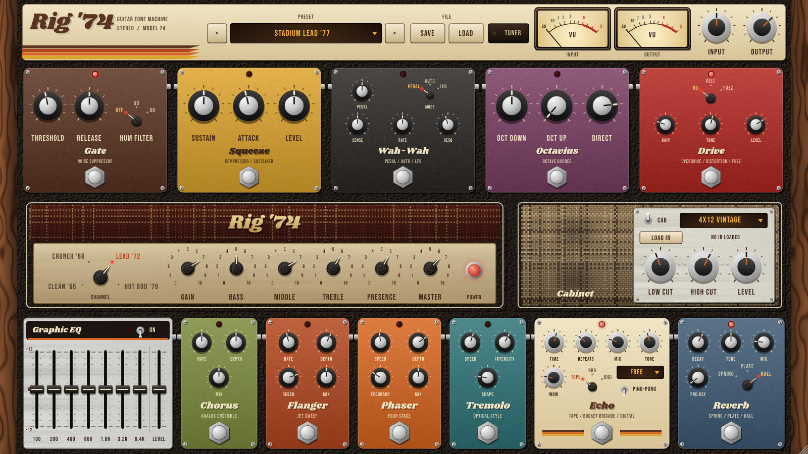

# Rig '74 — гітарний процесор у стилі 70-х

VST3 / AU / Standalone плагін для електрогітари: педалборд, ламповий підсилювач, кабінет з IR і стійка ефектів в одному вікні.



## Ланцюг сигналу

```
Гітара → INPUT → Hum filter → Gate (детектор) → Squeeze → Wah-Wah → Octavius → Drive
       → [4x oversampling]  Amp (преамп → тонстек → підсилювач потужності)
       → Cabinet (IR) → Gate (приглушення) → Graphic EQ
       → Chorus → Flanger → Phaser → Tremolo → Echo → Reverb → OUTPUT
```

Гейт працює як класичний noise suppressor у петлі: слухає чисту гітару на вході, а приглушує сигнал **після** підсилювача й кабінету, де і є шум. Тому він закривається чисто навіть на хай-гейні.

## Ефекти

| Блок | Що вміє | Ручки |
|---|---|---|
| **Gate** | шумоподавлення + режекторний фільтр фону мережі 50/60 Гц | Threshold, Release, Hum Filter |
| **Squeeze** | компресор / сустейнер | Sustain, Attack, Level |
| **Wah-Wah** | ва-ва: ручний (можна автоматизувати в DAW або прив'язати до MIDI-педалі експресії), авто (за силою удару), LFO | Pedal, Mode, Sense, Rate, Reso |
| **Octavius** | аналоговий октавер: октава вниз (тригер) + октава вгору (випрямляч) | Oct Down, Oct Up, Direct |
| **Drive** | Overdrive (середина, м'яке обмеження), Distortion (жорстке діодне), Fuzz (асиметричний транзисторний) | Type, Gain, Tone, Level |
| **Amp** | 4 моделі: Clean '65, Crunch '68, Lead '72, Hot Rod '79; пасивний тонстек як у справжніх ламп; просідання живлення (sag) | Channel, Gain, Bass, Middle, Treble, Presence, Master, Power |
| **Cabinet** | 5 вбудованих кабінетів + **завантаження власних IR** (.wav/.aiff) | Speaker, Load IR, Low Cut, High Cut, Level |
| **Graphic EQ** | 7 смуг 100 Гц – 6.4 кГц, ±12 дБ | 7 фейдерів + Level |
| **Chorus** | стерео-хорус у стилі BBD | Rate, Depth, Mix |
| **Flanger** | джет-флейнджер з регенерацією (+/−) | Rate, Depth, Regen, Mix |
| **Phaser** | 4-ступеневий фейзер зі зворотним зв'язком | Speed, Depth, Feedback, Mix |
| **Tremolo** | від м'якого синуса до рубленого «квадрата» | Speed, Intensity, Shape |
| **Echo** | Tape (wow/flutter, насичення), BBD (темний аналог), Digital; синхронізація з темпом DAW; пінг-понг | Time, Repeats, Mix, Tone, Wow, Mode, Sync, Ping-Pong |
| **Reverb** | Spring (модель пружинного бака з «бойнгом»), Plate, Hall | Decay, Tone, Mix, Pre-Dly, Type |
| **Tuner** | тюнер на стрілці VU-метра (вимикає звук на час налаштування) | кнопка TUNER |

**14 заводських пресетів:** Init Rig, Sunday Clean, Crunch '68, Stadium Lead '77, Fuzz Machine, Funky Wah, Space Echo Dream, Phased Out, Surf Tremolo, Jet Flanger, Octave Freakout, Hot Rod '79, Jazz Box, Doom Sub Octave. Вони також доступні в списку програм плагіна у DAW.
Власні звуки зберігаються кнопками **SAVE / LOAD** у файли `.rig74` (папка `Документи/Rig74 Presets`).

## Керування

- **Тягни** ручку вгору/вниз; **подвійний клік** повертає значення за замовчуванням; під час руху з'являється підказка зі значенням.
- **Перемикачі режимів** (OD/DIST/FUZZ, TAPE/BBD/DIGI тощо): клік перемикає на наступне положення, а ще можна тягнути.
- **Футсвіч** (хромована кнопка) вмикає/вимикає педаль, червоний світлодіод показує стан. Вмикання й вимикання плавні, без клацань.
- **Червоний «камінь»** на підсилювачі вмикає/вимикає сам підсилювач.
- Вікно можна **розтягувати** за правий нижній кут, пропорції зберігаються.
- **Рівень входу:** крути INPUT так, щоб стрілка вхідного VU на сильному ударі доходила приблизно до «0».

## Як отримати готовий плагін (без встановлення компілятора)

1. Створи новий репозиторій на GitHub і завантаж туди вміст цієї папки (через сайт: *Add file → Upload files*, або `git push`).
2. Відкрий вкладку **Actions**: збирання запуститься само (≈10–15 хв).
3. Коли з'явиться зелена галочка, відкрий запуск і внизу, в розділі **Artifacts**, завантаж:
   - `Rig74-Windows`: `Rig 74.vst3` + `Rig 74.exe` (standalone);
   - `Rig74-macOS`: VST3 + AU + `.app` (universal: Apple Silicon та Intel);
   - `Rig74-Linux`.
4. Хочеш оформлений реліз? Створи тег `v1.0.0`, і zip-архіви з'являться в **Releases**.

## Встановлення

**Windows:** скопіюй папку `Rig 74.vst3` у `C:\Program Files\Common Files\VST3\`, потім пересканує плагіни в DAW.
- FL Studio: *Options → Manage plugins → Find more plugins*, потім додай Rig 74 на канал Mixer, на який заведено вхід гітари.
- Reaper / Ableton / Cubase / Studio One: просто пересканувати VST3.
- `Rig 74.exe` працює без DAW: *Options → Audio settings*, обери звукову карту (тип **Windows Audio (Exclusive Mode)** дає найменшу затримку) і вхід з гітарою. ASIO-драйвери звукової карти доступні, коли плагін працює всередині DAW.

**macOS:** `Rig 74.vst3` → `~/Library/Audio/Plug-Ins/VST3/`, `Rig 74.component` → `~/Library/Audio/Plug-Ins/Components/`.
Збірка не підписана, тому один раз виконай у Терміналі:
```
xattr -cr ~/Library/Audio/Plug-Ins/VST3/"Rig 74.vst3" ~/Library/Audio/Plug-Ins/Components/"Rig 74.component"
```

**Linux:** `Rig 74.vst3` → `~/.vst3/`.

> Гітара йде в **моно**. Якщо в DAW стерео-доріжка, а гітара тільки в лівому каналі, плагін сам це помітить і візьме лівий канал. Вихід стерео (хорус, ехо й ревербератор розходяться по каналах).

## Локальне збирання

Потрібні CMake 3.22+ і компілятор C++17 (Windows: Visual Studio 2022 з компонентом «Desktop development with C++»; macOS: Xcode). JUCE 8 завантажується автоматично.

```
cmake -B build -DCMAKE_BUILD_TYPE=Release
cmake --build build --config Release --target Rig74_VST3 Rig74_Standalone
```

Тести (рендеринг звуку через усі пресети, фазинг параметрів, тюнер, скріншот GUI):
```
cmake -B build -DRIG74_BUILD_TESTS=ON
cmake --build build --target Rig74Test
./build/Rig74Test_artefacts/Release/Rig74Test test_out
```

## Структура

```
Source/
  PluginProcessor.*   ланцюг обробки, стан, пресети, тюнер
  Parameters.*        усі 83 параметри (ID, діапазони)
  Presets.*           заводські пресети
  dsp/                Dynamics (gate, hum, comp), PreFx (wah, octave), Drive, Amp (тонстек),
                      Cabinet (+ генерація IR), ModFx (EQ, chorus, flanger, phaser, tremolo),
                      TimeFx (echo, spring/plate/hall), Tuner (YIN)
  gui/                RetroLookAndFeel (ручки, футсвічі, текстури), Widgets (педалі, підсилювач, VU)
Resources/fonts/      Shrikhand та Bebas Neue (SIL Open Font License)
tools/                офлайн-тести і міні-хост для перевірки .vst3
```

## Ліцензії

- Фреймворк [JUCE 8](https://juce.com): безкоштовний для особистого використання та невеликих проєктів (див. ліцензію JUCE, якщо плануєш продавати плагін).
- VST — торгова марка Steinberg Media Technologies GmbH.
- Шрифти Shrikhand і Bebas Neue: SIL Open Font License 1.1 (тексти в `Resources/fonts`).
- Назви моделей підсилювачів і кабінетів умовні й не прив'язані до брендів.
